<picture>
  <source media="(prefers-color-scheme: dark)" srcset="./assets/header-dark.svg">
  
</picture>

  
  
  
  

### `$ whoami`

Software engineer with **9 years** shipping production systems, now building **applied AI**.
MSc in AI for Business Analytics (KMITL, 2025) and **first author of an IEEE paper** on Thai/English sentiment analysis.
I bring the engineering side AI work needs: backend services, Docker/Kubernetes deployment, and platforms real users depend on.

- **Now** — Senior Developer at WHA Group: digital signature, document and back-office platforms on Docker, Kubernetes and Huawei Cloud.
- **Building** — offline OCR for Thai legal documents with a local vision-language model, and an LLM-curated engineering knowledge base.
- **Open to** — AI Engineer / AI Application Engineer roles, hybrid, Bangkok and Samut Prakan.

### `$ ls ./selected-work`

| | Project | Stack |
|:--|:--|:--|
| `01` | **Offline Thai Legal-Document OCR** · *ongoing* Scanned Thai contracts → Markdown and searchable PDFs, fully offline: docTR line detection → Typhoon OCR 1.5 (2B Thai VLM) → line-level text layer. Evaluation harness on a verified gold set (CER, WER, flag rate, search recall, speed) with pass rules set before each run. | Python · docTR · Typhoon OCR · MLX · transformers · PyMuPDF · PyThaiNLP · DuckDB |
| `02` | **Personal Engineering Brain** · *2026* Turns RSS, web clips and GitHub releases on AI, MLOps and markets into deduplicated, linked notes and daily/weekly/monthly summaries. LLM agents summarise, classify and dedupe; plain-Python validators check schema, links and dates before every commit. | Python · Claude Code / Codex · Obsidian · Markdown + YAML · GitHub API |
| `03` | **[Thailand Tourism Recommender](https://github.com/S09Z/IS_Project_Thailand_Tourism_Recommendation)** · *2024–2025* Ranks 2,847 Thai destinations by combining review sentiment, FastText semantic search and DBSCAN tag clustering. Benchmarked 7 classifiers on 5,909 Thai/English reviews. | Python · NLTK · FastText · SVM · LSTM · DBSCAN |

### `$ cat ./publication.txt`

> **Text Sentiment Analysis for Thailand Tourism Recommendation** 
> **I. Boonyarakthunya**, S. Chotipant · *2025 22nd International Joint Conference on Computer Science and Software Engineering (JCSSE)*, IEEE 
> [IEEE Xplore ↗](https://ieeexplore.ieee.org/document/11297945)

### `$ stack --by-area`

| Area | Tools |
|:--|:--|
| **AI / ML** | Python · NLP (Thai & English) · local VLMs (Typhoon OCR, MLX, transformers) · LSTM / GRU / CNN · SVM · FastText · DBSCAN · OCR evaluation (CER / WER) |
| **Engineering** | TypeScript · Golang · Node.js · Next.js · React · Vue 3 / Nuxt · Laravel / PHP · REST · GraphQL · Prisma / TypeORM · Kafka |
| **Data** | PostgreSQL · MySQL · MongoDB · Redis · DuckDB · Parquet |
| **Platform** | Docker · Kubernetes · Huawei Cloud · CI/CD · Jaeger · Git |
| **Quality** | Jest · Cypress · TDD · Scrum |

`S09Z::oat` · built in Bangkok · <a href="https://s09z.github.io/">s09z.github.io</a>
